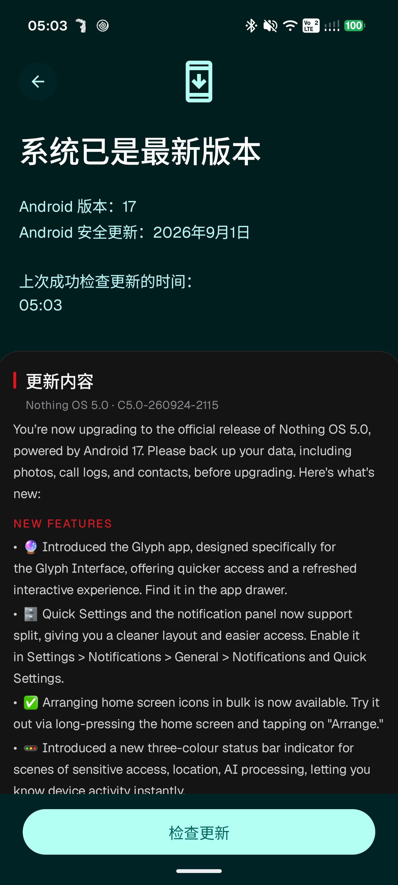
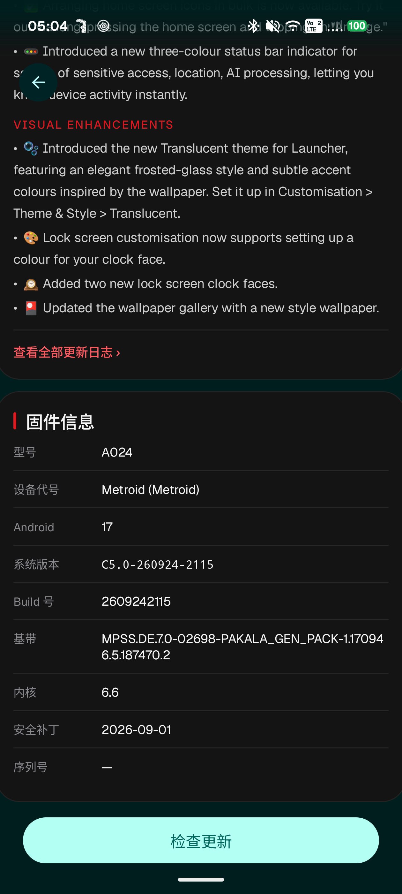
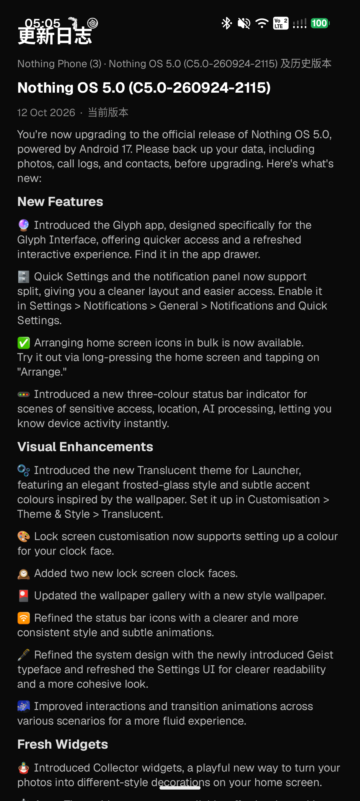
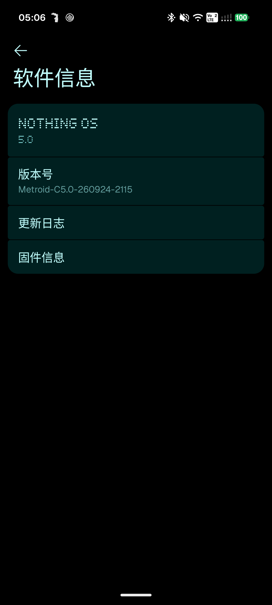

# Nothing Update Fix

> LSPosed/Xposed module (classic API 82) that restores the missing **update changelog** and
> **firmware info** content in the System Update page and the Software Info page of a rooted
> **Nothing Phone (3)** (Nothing OS 5.0 / Android 17, build `C5.0-260924-2115`).

- Package: `io.github.rtzhang.nothingupdatefix` · Label: `Nothing update fix` · minSdk 26 / targetSdk 37
- Full root-cause analysis with evidence chain: [`docs/ROOT_CAUSE.md`](docs/ROOT_CAUSE.md)
- Evidence screenshots: [`screenshots/`](screenshots/) (broken state + on-device verification)

## What's new in v1.0.1

- **Update page: two Nothing-styled cards injected directly into the GMS System Update page**
  (`com.google.android.gms`), so content no longer depends on the OTA state machine:
  - **What's New** card — the current-version body from the module's bundled `changelog.json`
    plus a *查看全部更新日志 ›* link into the module's `ChangelogActivity`;
  - **Firmware info** card — model `A024`, codename `Metroid`, Android 17, system version,
    build number, baseband, kernel, security patch, serial number (all read live from `Build`
    properties at runtime);
  - Both cards render **even with no pending update** — the v1.0.0 *pending-update state gate*
    limitation is thereby closed. Injection is idempotent (view tag) and anchored on the
    `SystemUpdateChimeraActivity` lifecycle (see the Chimera note in
    [§7 Module architecture](#7-module-architecture) — it is a Chimera *module delegate*, not an
    `Activity`).
- **About link fixed** to point at the real repository URL.
- Verified on a real Nothing Phone (3): both cards render, the changelog link jumps, Link A
  still works. APK sha256 `c3f49ca4…` (see screenshots below).

## On-device screenshots (Nothing Phone (3), v1.0.1 verified, 2026-11-10)

| Update page — injected **What's New** card (no pending OTA) | Update page — injected **firmware info** card + "查看全部更新日志" link |
|---|---|
|  |  |

| "查看全部更新日志" → module `ChangelogActivity` | Software Info page — Link A regression (v1.0.1) |
|---|---|
|  |  |

Earlier v1.0.0 captures (Link A entries, module status screen, the pre-fix state-gated
update page) are kept in [`screenshots/`](screenshots/) and indexed in
[`screenshots/README.md`](screenshots/README.md).


## 1. Problem

After rooting (Magisk + LSPosed/Vector), two Nothing-customized content surfaces disappear:

| Surface | Stock behavior | Observed after root |
|---|---|---|
| **System Update page** (GMS gOTA client, `com.google.android.gms/.update.SystemUpdateActivity`) | "What's New" changelog block + firmware info line, fed by server-side OTA metadata | Bare GLIF shell: "系统已是最新版本" + version lines + **Check for updates** only |
| **Software Info page** (`Settings → About phone → Software info`, `DeviceSoftwareInfoFragment`) | Dynamic "更新日志" / "固件信息" cards | Only static cards + a black empty area |

## 2. Root cause (short version)

The content was never stored on the device — it is **server-delivered, and both delivery channels
broke independently**:

1. **Update page**: the changelog lives in the GMS Gservices flags `update_title` /
   `update_description` / `update_size`, assembled into `UpdateDescription` (4 `String` fields)
   and rendered in the GLIF layout. When `update_description` is empty, the whole block is hidden
   (`setVisibility(8)`). The device-side Gservices rows for these keys are currently absent —
   in part because GMS data was cleared during troubleshooting, which wipes the already-fetched
   OTA metadata cache (same failure mode as Huawei's official FAQ: "clear update cache → current
   version changelog is empty until the next OTA").
2. **Software Info page**: its dynamic cards come from Nothing's online config service
   `iota.nothing.tech` (`settings_recommendation` payload). That endpoint currently answers
   **503** (AWS ALB unhealthy target group — confirmed from 10 probes across 3 continents), and
   the APK-local fallback `res/raw/settings_recommendation.json` contains **no card for
   `DeviceSoftwareInfoFragment`** — so the page has nothing to show.

### Fix principle

```
        STOCK (broken)                              WITH THIS MODULE
  ┌─────────────────────────────┐          ┌──────────────────────────────────┐
  │ iota.nothing.tech  → 503    │          │ Link A (com.android.settings)    │
  │   settings_recommendation   │          │  hook onCreatePreferences(...)   │
  │   (no card for this page)   │  ──X──►  │   └ addPreference:               │
  │ Software Info = static +    │          │      "更新日志" → ChangelogActivity│
  │   black area                │          │      "固件信息" → SoftVersion…    │
  ├─────────────────────────────┤          ├──────────────────────────────────┤
  │ GMS Gservices               │          │ Link B (com.google.android.gms)  │
  │   update_title/desc/size    │          │  hook Gservices query()          │
  │   = ABSENT (cache wiped)    │  ──X──►  │   └ MatrixCursor re-injects      │
  │ UpdateDescription.b = null  │          │      update_title/description/…  │
  │   → setVisibility(8)        │          │      (built-in changelog HTML)   │
  └─────────────────────────────┘          └──────────────────────────────────┘
```

The module never touches system partitions — everything is done in-process via hooks, and all
displayed content is either bundled (changelog JSON) or read live from device properties.

## 3. Features

- **Link A — Software Info page entries** (scope `com.android.settings`):
  injects two preferences into `DeviceSoftwareInfoFragment`:
  - **更新日志 (Changelog)** → module's own `ChangelogActivity`, rendering the bundled changelog
    (`assets/changelog.json`: current build + 7 historical versions, sourced from
    nothingfirmware.github.io / nothingarchive.tech).
  - **固件信息 (Firmware info)** → Nothing's own `SoftVersionDisplayActivity`
    (`com.nothing.settings.softwareinfo`), fully local content.
  - Idempotent injection (`findPreference` de-dup guard), dual routing (interface hook with
    class-name guard + direct concrete-method hook fallback).
- **Link B — Update page changelog** (scope `com.google.android.gms`):
  hooks `ContentResolver.query` / `ContentProviderClient.query` (all public overloads); when the
  authority is `com.google.android.gsf.gservices`, the result cursor is rebuilt with a
  `MatrixCursor` that overwrites/appends `update_title` / `update_description` / `update_size`.
  Both query shapes are handled (key-list `selectionArgs` and `/prefix/<p>` URIs). The
  `update_description` HTML is assembled at runtime (changelog sections + firmware info table —
  baseband `gsm.version.baseband`, kernel `ro.kernel.version`/uname, build `ro.build.display.id`
  — all read live with try/catch fallbacks).
- **Link C — Update page cards, view injection (v1.0.1, scope `com.google.android.gms`)**:
  instead of relying on GMS rendering the `update_description` payload, the module builds and
  inserts two cards itself, as siblings after the version-summary `TextView`
  (`id/description`):
  - **What's New** card: heading + `Nothing OS 5.0 · C5.0-260924-2115` + the current version's
    sections from `assets/changelog.json` (first 3 sections × 4 bullets, the rest behind the
    link) + a *查看全部更新日志 ›* `TextView` that opens the module's `ChangelogActivity`;
  - **Firmware info** card: 型号 / 设备代号 / Android 版本 / 系统版本 / Build 号 / 基带 / 内核 /
    安全补丁 / 序列号, each read at render time from `android.os.Build` /
    `ro.*` properties / `/proc/version` with per-row try/catch fallbacks;
  - Rendered **regardless of the OTA state** (the page may still say "系统已是最新版本") — the
    injection is decoupled from `UpdateDescription` / `SystemUpdateStatus`;
  - Idempotent: the cards container carries a view tag (`nuf_gms_cards_v1`), so repeated
    `onCreate` / `onResume` passes (check-for-updates, back navigation) add nothing twice;
  - Anchored on the `SystemUpdateChimeraActivity` lifecycle (L1) with two fallbacks
    (L2 hijacked-renderer probes, L3 generic `Activity.onResume`), see §7 for the Chimera trap.
- **Bonus hook**: `com.google.android.gms.update.UpdateDescription(String,String,String,String)`
  constructor — fills **empty** fields only (`setIfEmpty`), so a real OTA description is never
  overwritten.
- **Status page**: hook hit log (via `XposedBridge.log` + a `ContentProvider` round-trip),
  last 40 lines, refresh/clear.
- **Built-in changelog viewer** and adaptive launcher icon (black + dot-matrix "N", Nothing
  dot-matrix aesthetics).

## 4. Requirements

- **Device**: Nothing Phone (3) (A024 / Metroid), Nothing OS 5.0 / Android 17 (API 37),
  build `C5.0-260924-2115` (may work on nearby builds; the GMS hook targets GMS 26.43.30
  internals, see limitations).
- **Root**: Magisk (tested with v31.1, systemless).
- **Xposed framework**: LSPosed — the original LSPosed is EOL and does not support Android 17;
  use the maintained **[JingMatrix/Vector](https://github.com/JingMatrix/LSPosed)** branch
  (v2.0+ renamed *Vector*; v2.1+ officially supports Android 8.1–17; tested with v2.2 / 3080,
  installed as Zygisk module `zygisk_vector`). An install helper is provided in
  [`tools/install_lsposed.sh`](tools/install_lsposed.sh).
- **Module scope** (declared in `assets/xposed_scope`, must be enabled in the manager):
  `com.android.settings` and `com.google.android.gms`.
- **Reboot** after enabling the module (or force-stop Settings + Google Play services).

## 5. Build

```bash
bash build.sh
```

Output: `release/NothingUpdateFix.apk` (zipalign 4 + v2/v3 signed) + `.sha256`.

Dependencies (the script resolves/downloads most of them):

- **Android SDK** build-tools `37.0.0` + platform `android-37.0` (Android 17 / API 37);
  override with `ANDROID_SDK_ROOT` / `ANDROID_HOME`.
- **JDK** — Android Studio JBR by default (`C:/Program Files/Android/Android Studio/jbr`),
  override with `JAVA_HOME`.
- `vendor/XposedBridgeApi-82.jar` — compile-time only, auto-downloaded from api.xposed.info if
  missing; **never packed into the dex** (build.sh enforces this with a `dexdump` check).
- Python 3 + Pillow (launcher icon generation only).

Signing: a `keystore/release.jks` is auto-generated on first build (password `nothingupdatefix`).
The keystore is **not** committed to git (see `.gitignore`) — a fresh checkout will produce an
equivalent APK signed with its own key.

The script runs full verification on every build: `aapt2 dump badging` (label / SDKs / icon),
`dexdump` (all module classes present, **zero** `de.robv.android.xposed.*` class definitions),
`apksigner verify` (v2/v3) and SHA-256 output.

## 6. Install & enable

1. Install `release/NothingUpdateFix.apk`.
2. In the LSPosed/Vector manager: enable **Nothing update fix**, scope =
   `com.android.settings` + `com.google.android.gms`.
3. Reboot (or force-stop Settings and Google Play services, then reopen the pages).
4. Check the app's **Status** section for hook hit logs.

## 7. Module architecture

```
MainHook (IXposedHookLoadPackage, xposed_init)
├─ Link A — handleLoadPackage("com.android.settings")
│   route1: hook androidx.preference.PreferenceFragmentCompat.onCreatePreferences(Bundle,String)
│           guard: thisObject class == com.nothing.settings.deviceinfo.aboutphone
│                  .DeviceSoftwareInfoFragment
│   route2: fallback — scan class hierarchy, hook most-derived concrete onCreatePreferences
│   probe:   NothingSettings R8-renames androidx.preference members (title/intent fields,
│            addPreference) — resolved at runtime by type signature + behavioural probes on
│            throw-away instances, never on the host's live objects
│   inject:  PreferenceScreen.addPreference() ×2 (pure reflection, host-agnostic)
│           nuf_changelog  → ChangelogActivity (in-module, exported)
│           nuf_fwinfo     → com.nothing.settings.softwareinfo.SoftVersionDisplayActivity
│
├─ Link B — handleLoadPackage("com.google.android.gms")
│   hook ContentResolver.query ×4 overloads + ContentProviderClient.query ×4 overloads
│   when uri.authority == "com.google.android.gsf.gservices":
│       run original query → rebuild rows into MatrixCursor (same column names)
│       overwrite/append  update_title / update_description / update_size
│   plus: UpdateDescription(String,String,String,String) ctor → setIfEmpty fill
│
├─ Link C — handleLoadPackage("com.google.android.gms")   [v1.0.1 view injection]
│   L1: hook SystemUpdateChimeraActivity#onCreate/onResume  (primary anchor)
│       resolveActivity(): delegate→Activity via 0-arg getters / Activity fields,
│       else ActivityThread.getActivities() → pick the one that findViewById's the anchor
│       anchor id/description → insert GmsPageInjector cards (tag nuf_gms_cards_v1)
│   L2: OtaUiController "no-update" renderer (gtah.i) + shared renderer (gtak.a) probes
│   L3: generic Activity.onResume fallback (only if L1 never resolved)
│
└─ StatusProvider (ContentProvider) — hook hit log sink for the in-app status screen
```

Supporting pieces: `ChangelogData` (JSON + runtime HTML assembly), `ChangelogView` /
`ChangelogActivity` (renderers), `GmsPageInjector` (update-page cards), `scripts/gen_icons.py`
(adaptive icon), `build.sh` (reproducible pipeline with hard verification gates).

### Chimera pitfall (why the update page is a special case)

`com.google.android.gms.update.phone.SystemUpdateChimeraActivity` is **not** an
`android.app.Activity` — it is a *Chimera module delegate* that extends the container-provided
`com.google.android.chimera.android.Activity`. Hooking `Activity#onCreate` and casting the
`thisObject` therefore throws `ClassCastException` (that was the v1.0.1 first-round failure), and
the real window is owned by the container Activity
`com.google.android.gms.update.SystemUpdateActivity`. The module resolves the host in this order:
reflected `Activity` getters/fields on the delegate → `ActivityThread.getActivities()` scan,
picking the instance whose `findViewById` finds the anchor id. Entity ids are resolved by
**resource name** at runtime (`getIdentifier`), because their numeric values change with the GMS
version.

## 8. Known limitations

1. ~~**Pending-update state gate**~~ — **solved in v1.0.1 by view injection**. GMS still gates
   *its own* What's New block at the UI level when there is no pending OTA (confirmed by a direct
   gservices injection probe — `docs/ROOT_CAUSE.md` §E5 — and on device: the `UpdateDescription`
   constructor hook fired 5× while the page stayed bare). That is stock behavior and Link B
   cannot change it; Link C (v1.0.1) therefore renders the cards itself, independent of the OTA
   state, so both cards appear in the "already up to date" state. Historical evidence:
   `screenshots/device_update_page_state_gate.png`.
2. **GMS checkin behavior**: GMS rewrites/clears the `update_%` namespace of Gservices on
   checkin — direct DB injection does not persist. This module's hooks are unaffected (they
   intercept at query time), but any manual DB edits will be wiped.
3. **GMS upgrade compatibility**: the bonus `UpdateDescription` hook relies on the field names
   `a/b/c/d` in GMS 26.43.30 (anchored by disassembly evidence). A GMS update may rename them —
   the hook then fails silently (fully try/catch'd) and the Gservices main hook still works.
4. **No settings toggle**: hooks are always on (XSharedPreferences is unreliable on modern
   Android). The module has no side effects beyond adding UI entries and display text.
5. **`update_size` shows the build string**, not a package size (real OTA size is unknowable
   offline). Delete the key if GMS formats it as a file size and looks odd.
6. **Not bit-reproducible builds** (zip timestamps); the pipeline itself is reproducible.
7. **Renderer-probe hook (L2) installed but never observed firing** on device (`gtah.i` never
   logged `fired`, `gtak` shape probe misses — that renderer is only reachable in the
   "update available" state family). It only matters for re-injection after a state redraw; the
   cards persist until removed and L1 re-injects on resume, so this does not affect the result.
8. **Anchor ids are GMS-version dependent**: the card container is inserted next to
   `id/description`, resolved by resource *name* at runtime. A future GMS layout change makes the
   anchor lookup fail — logged, cards skipped, no crash.
9. Device verification status: **verified on a real Nothing Phone (3)** (Nothing OS 5.0 /
   build `C5.0-260924-2115`, 2026-11-10, v1.0.1) — update-page What's New + firmware cards
   render without a pending OTA, the changelog link jumps, Link A still works. See the
   screenshots above and [`screenshots/README.md`](screenshots/README.md).
10. The v1.0.1 APK is the exact build verified on device (sha256 `c3f49ca4…`); its internal
    `versionName` still reads `1.0` because it was not rebuilt after tagging — rebuild from this
    tree to get a matching label (the sha256 will differ).

## 9. Acknowledgments

- **[JingMatrix/Vector](https://github.com/JingMatrix/LSPosed)** — the actively maintained
  LSPosed continuation that makes Xposed modules possible on Android 15–17.
- **LSPosed / XposedBridge** — the original framework and the classic module API (82) this
  module is built on; `XposedBridgeApi-82.jar` is used as compile-time dependency only.
- **[nothingarchive.tech](https://nothingarchive.tech)** community (and
  [nothingfirmware.github.io](https://nothingfirmware.github.io)) — firmware/changelog archives
  that made the bundled changelog data possible.
- **nothing.community** — firmware update threads used as changelog reference.

## 10. License & disclaimer

MIT — see [LICENSE](LICENSE). Copyright (c) 2026 rtzhang.

**Use at your own risk.** Rooting, unlocking the bootloader and running Xposed-style hooks carry
real dangers: bootloops, data loss, tripped integrity checks (Play Integrity / Widevine L3),
voided warranty, and potential breakage after OTA or GMS updates. This module only *displays*
information and adds UI entries — it does not modify system partitions — but hooking
`com.android.settings` and `com.google.android.gms` can interact with future vendor/GMS changes
in unforeseen ways. Always keep a backup and know how to recover (stock image + fastboot).
The authors are not responsible for any damage, data loss, or warranty consequences.
