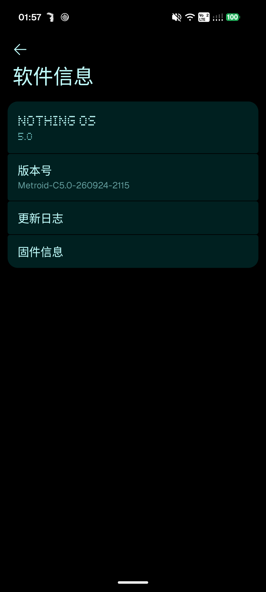
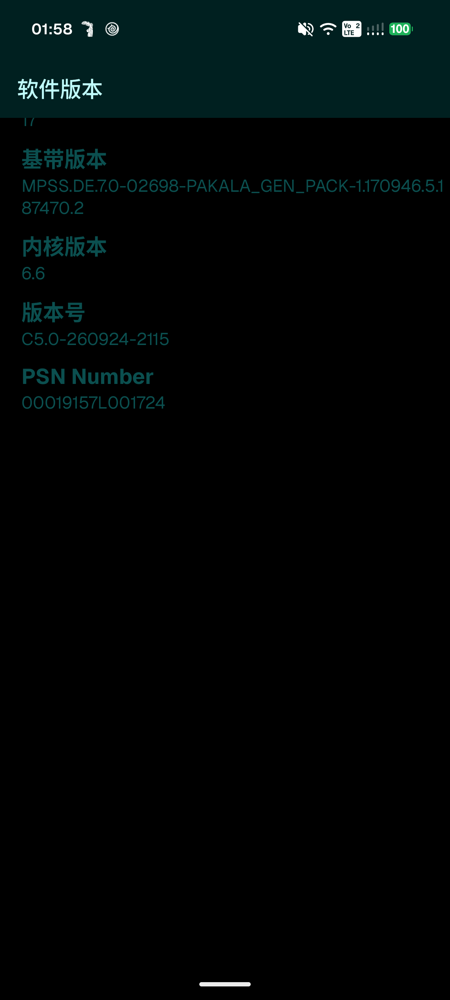
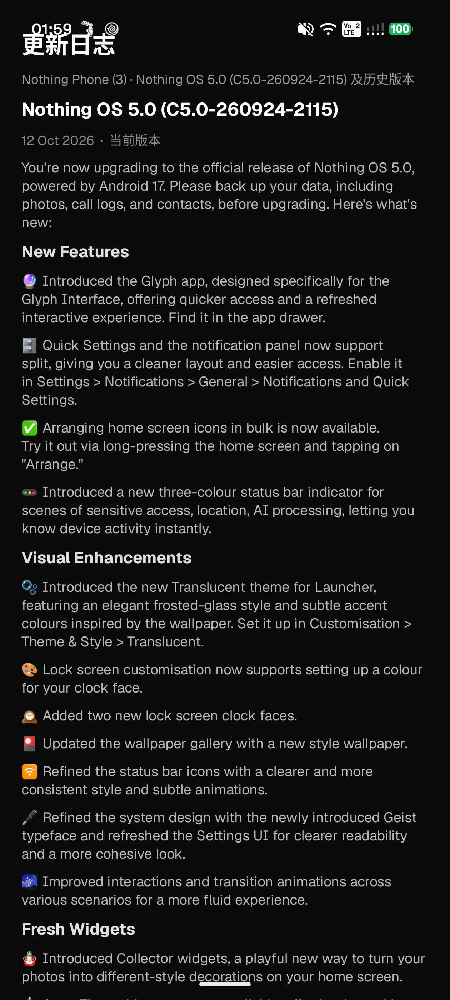
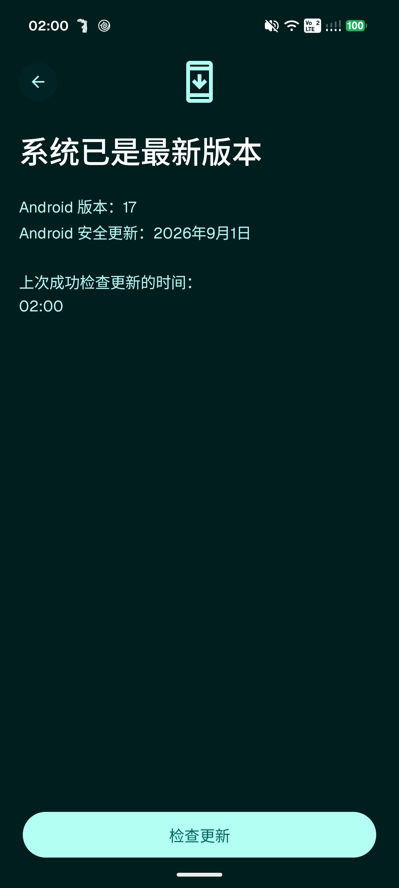
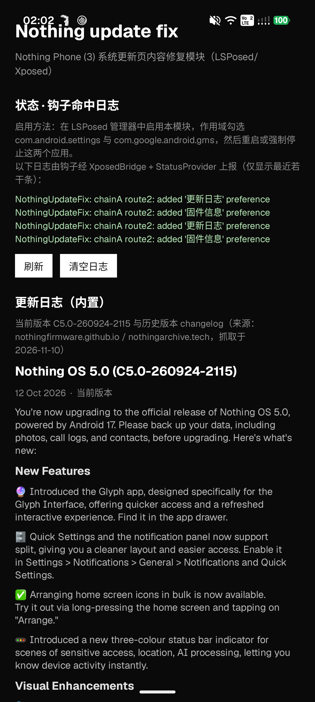

# Nothing Update Fix（中文）

> LSPosed/Xposed 模块（经典 API 82），修复 root 后 Nothing Phone (3)（Nothing OS 5.0 /
> Android 17，build `C5.0-260924-2115`）**系统更新页**与**软件信息页**丢失的
> 「更新日志」与「固件信息」定制内容。

- 包名：`io.github.rtzhang.nothingupdatefix` · 应用名：`Nothing update fix` · minSdk 26 / targetSdk 37
- 完整根因分析与证据链：[`docs/ROOT_CAUSE.md`](docs/ROOT_CAUSE.md)（英文）
- 证据截图：[`screenshots/`](screenshots/)（断链状态 + 真机验证）

## 真机截图（Nothing Phone (3)，验证版 `6611d645…`）

| 软件信息页 · 注入入口（链路 A） | 固件信息（链路 A） | 更新日志（链路 A） |
|---|---|---|
|  |  |  |

| 更新页 · What's New 状态门（链路 B） | 模块状态页 / 钩子命中日志 |
|---|---|
|  |  |

## 1. 问题

root（Magisk + LSPosed/Vector）之后，两处 Nothing 定制内容消失：

| 界面 | 原厂形态 | root 后实际 |
|---|---|---|
| **系统更新页**（GMS gOTA 客户端 `com.google.android.gms/.update.SystemUpdateActivity`） | "What's New" 更新日志块 + 固件信息行（服务端随 OTA 元数据下发） | GLIF 裸壳：「系统已是最新版本」+ 版本行 + 「检查更新」按钮 |
| **软件信息页**（`设置 → 关于手机 → 软件信息`，`DeviceSoftwareInfoFragment`） | 「更新日志」「固件信息」动态卡片 | 只剩静态卡 + 大块黑区 |

## 2. 根因（简版）

**内容从来不存本地，全部服务端下发——而两条下发通道各自独立断了：**

1. **更新页**：changelog 的真身是 GMS Gservices 标志 `update_title` / `update_description` /
   `update_size`，由 GMS 组装进 `UpdateDescription`（4 个 `String` 字段）渲染到 GLIF 布局；
   `update_description` 为空 → 整块 `setVisibility(8)` 隐藏。本机 Gservices 中这三个键
   **ABSENT**——排查期清过 GMS 数据，把已拉取的 OTA 元数据缓存一并清掉（华为官方 FAQ
   同病例：清更新缓存后当前版本日志不显示，等新版本推送才恢复）。
2. **软件信息页**：动态卡片来自 Nothing 在线配置服务 `iota.nothing.tech`
   （`settings_recommendation` 载荷）。该端点当前返回 **503**（AWS ALB 目标组不健康，
   10 国 3 大洲探针证实），而 APK 本地兜底 `res/raw/settings_recommendation.json` 里
   **没有 `DeviceSoftwareInfoFragment` 的卡片** → 该页无内容可渲。

### 修复原理

```
        原厂（断链状态）                            本模块介入后
  ┌─────────────────────────────┐          ┌──────────────────────────────────┐
  │ iota.nothing.tech  → 503    │          │ 链路 A（com.android.settings）   │
  │   settings_recommendation   │          │  hook onCreatePreferences(...)   │
  │   （该页无卡片）             │  ──X──►  │   └ addPreference：              │
  │ 软件信息页 = 静态卡 + 黑区   │          │      「更新日志」→ChangelogActivity│
  │                             │          │      「固件信息」→SoftVersion…    │
  ├─────────────────────────────┤          ├──────────────────────────────────┤
  │ GMS Gservices               │          │ 链路 B（com.google.android.gms） │
  │   update_title/desc/size    │          │  hook Gservices query()          │
  │   = ABSENT（缓存被清）       │  ──X──►  │   └ MatrixCursor 重建注入        │
  │ UpdateDescription.b = null  │          │      update_title/description/…  │
  │   → setVisibility(8) 隐藏   │          │      （内置 changelog HTML）      │
  └─────────────────────────────┘          └──────────────────────────────────┘
```

模块**不触碰系统分区**——全部进程内钩子完成，展示内容要么内置（changelog JSON），
要么运行时从系统属性实时读取。

## 3. 功能

- **链路 A — 软件信息页入口**（作用域 `com.android.settings`）：向
  `DeviceSoftwareInfoFragment` 注入两条 Preference：
  - **更新日志** → 模块自带 `ChangelogActivity`，渲染内置 changelog
    （`assets/changelog.json`：当前版 + 7 个历史版本，来源 nothingfirmware.github.io /
    nothingarchive.tech）；
  - **固件信息** → Nothing 自带 `SoftVersionDisplayActivity`
    （`com.nothing.settings.softwareinfo`），内容全部本地。
  - 注入幂等（`findPreference` 去重），双路由（接口钩 + 类名守卫 / 具体方法直钩兜底）。
- **链路 B — 更新页 changelog**（作用域 `com.google.android.gms`）：钩
  `ContentResolver.query` / `ContentProviderClient.query` 全部公开重载；authority 为
  `com.google.android.gsf.gservices` 时以 `MatrixCursor` 按原列名重建结果，覆盖/追加
  `update_title` / `update_description` / `update_size`。兼容键名列表 selectionArgs 与
  `/prefix/<p>` 两种查询形态。`update_description` HTML 运行时拼装（changelog 分节 +
  固件信息表——基带 `gsm.version.baseband`、内核 `ro.kernel.version`/uname、build
  `ro.build.display.id` 实时读取，全部 try/catch 兜底）。
- **加分钩子**：`com.google.android.gms.update.UpdateDescription(String,String,String,String)`
  构造器，**仅补空字段**（`setIfEmpty`），绝不覆盖真实 OTA 描述。
- **状态页**：钩子命中日志（`XposedBridge.log` + `ContentProvider` 回传），最近 40 行，
  可刷新/清空。
- **内置 changelog 查看器** + 自适应启动器图标（黑底白点阵 "N"，Nothing 点阵美学）。

## 4. 安装要求

- **设备**：Nothing Phone (3)（A024 / Metroid），Nothing OS 5.0 / Android 17（API 37），
  build `C5.0-260924-2115`（相近 build 大概率可用；GMS 钩子针对 GMS 26.43.30 内部结构，
  见已知限制）。
- **Root**：Magisk（实测 v31.1，systemless）。
- **Xposed 框架**：LSPosed——原版 LSPosed 已停更且不支持 Android 17；请用维护中的
  **[JingMatrix/Vector](https://github.com/JingMatrix/LSPosed)** 分支（v2.0 起更名 Vector，
  v2.1+ 官方支持 Android 8.1–17；实测 v2.2 / 3080，Zygisk 模块 `zygisk_vector`）。
  安装辅助脚本：[`tools/install_lsposed.sh`](tools/install_lsposed.sh)。
- **模块作用域**（`assets/xposed_scope` 已声明，需在管理器勾选）：
  `com.android.settings` + `com.google.android.gms`。
- **重启**（或强停 设置 + Google Play 服务后重进页面）。

## 5. 构建

```bash
bash build.sh
```

产物：`release/NothingUpdateFix.apk`（zipalign 4 + v2/v3 签名）+ `.sha256`。

依赖（脚本自动处理大部分）：

- **Android SDK** build-tools `37.0.0` + platform `android-37.0`（Android 17 / API 37）；
  可用 `ANDROID_SDK_ROOT` / `ANDROID_HOME` 覆盖。
- **JDK**——默认 Android Studio JBR（`C:/Program Files/Android/Android Studio/jbr`），
  可用 `JAVA_HOME` 覆盖。
- `vendor/XposedBridgeApi-82.jar`——仅编译期依赖，缺失时从 api.xposed.info 自动下载；
  **绝不打进 dex**（build.sh 用 `dexdump` 硬校验保证）。
- Python 3 + Pillow（仅生成启动器图标）。

签名：首次构建自动生成 `keystore/release.jks`（密码 `nothingupdatefix`）。keystore
**不入 git**（见 `.gitignore`）——fresh checkout 会用自动生成的密钥签出等价 APK。

每次构建执行完整校验：`aapt2 dump badging`（label / SDK / 图标）、`dexdump`（模块类齐全、
**零** `de.robv.android.xposed.*` 类定义）、`apksigner verify`（v2/v3）与 SHA-256 输出。

## 6. 安装与启用

1. 安装 `release/NothingUpdateFix.apk`。
2. LSPosed/Vector 管理器：启用 **Nothing update fix**，作用域勾选
   `com.android.settings` + `com.google.android.gms`。
3. 重启（或强停 设置 与 Google Play 服务后重进相关页面）。
4. 打开本 APP「状态」区查看钩子命中日志。

## 7. 模块架构

```
MainHook (IXposedHookLoadPackage, xposed_init)
├─ 链路 A — handleLoadPackage("com.android.settings")
│   route1: hook androidx.preference.PreferenceFragmentCompat.onCreatePreferences(Bundle,String)
│           守卫：thisObject 类名 == com.nothing.settings.deviceinfo.aboutphone
│                  .DeviceSoftwareInfoFragment
│   route2: 兜底 — 沿类层级直钩最派生的具体 onCreatePreferences
│   探针：   NothingSettings 用 R8 混淆了 androidx.preference 成员（title/intent 字段、
│            addPreference）——运行时按类型签名 + 行为探针解析（探针只在自建一次性
│            实例上跑，绝不碰宿主对象）
│   注入：PreferenceScreen.addPreference() ×2（纯反射构造，不依赖宿主 androidx 版本）
│          nuf_changelog  → ChangelogActivity（模块内，exported）
│          nuf_fwinfo     → com.nothing.settings.softwareinfo.SoftVersionDisplayActivity
│
├─ 链路 B — handleLoadPackage("com.google.android.gms")
│   hook ContentResolver.query ×4 重载 + ContentProviderClient.query ×4 重载
│   uri.authority == "com.google.android.gsf.gservices" 时：
│       执行原查询 → MatrixCursor 按原列名重建结果行
│       覆盖/追加  update_title / update_description / update_size
│   加分：UpdateDescription(String,String,String,String) 构造器 → setIfEmpty 补空
│
└─ StatusProvider (ContentProvider) — 钩子命中日志回传，供 APP 状态页展示
```

配套组件：`ChangelogData`（JSON + 运行时 HTML 拼装）、`ChangelogView` /
`ChangelogActivity`（渲染）、`scripts/gen_icons.py`（自适应图标）、`build.sh`
（带硬校验门的可复现构建管线）。

## 8. 已知限制

1. **pending-update 状态门（真机实测）**：无待装 OTA 时，即使 `update_description` 有值，
   GMS 也会在 UI 层拦住 What's New 块（gservices 直注探针 `docs/ROOT_CAUSE.md` §E5 +
   真机双重证实：模块 `UpdateDescription` 构造钩命中 5 次，页面依旧裸壳，见
   `screenshots/device_update_page_state_gate.png`）。链路 B 恢复的是页面读取的数据；
   「已是最新版本」状态下整块不出现是**原厂行为**，只有真实待装更新时才会渲染。
2. **GMS checkin 行为**：checkin 会重写/清空 Gservices 的 `update_%` 命名空间——直接改库
   不持久。本模块钩子不受影响（查询时拦截），但手工注入的行会被清掉。
3. **GMS 升级兼容性**：加分 `UpdateDescription` 钩子依赖 GMS 26.43.30 的字段名
   `a/b/c/d`（反汇编证据锚定）。GMS 升级改名后该钩静默失效（全 try/catch），
   Gservices 主钩不受影响。
4. **无设置开关**：钩子常开（XSharedPreferences 在现代 Android 上不可靠）。模块除
   增加 UI 入口与展示文案外无任何副作用数据面。
5. **`update_size` 显示 build 号字符串**而非包体大小（离线无法得知真实 OTA 体积）。
   若 GMS 把该字段格式化为文件大小导致显示异常，删掉该键即可（规格允许省略）。
6. **构建非位级可复现**（zip 时间戳）；构建流程本身可复现。
7. 真机验证状态：**已在真机 Nothing Phone (3)（Nothing OS 5.0 / build `C5.0-260924-2115`，
   2026-11-10）验证通过**——链路 A 两个入口、固件信息页、更新日志页全部可用；链路 B 钩子
   命中，但 What's New 块受限制 1（状态门）约束。见上方截图与
   [`screenshots/README.md`](screenshots/README.md)。

## 9. 致谢

- **[JingMatrix/Vector](https://github.com/JingMatrix/LSPosed)**——持续维护的 LSPosed
  延续分支，让 Xposed 模块在 Android 15–17 上成为可能。
- **LSPosed / XposedBridge**——原版框架与本模块所用经典模块 API（82）；
  `XposedBridgeApi-82.jar` 仅作编译期依赖。
- **[nothingarchive.tech](https://nothingarchive.tech)** 社区（及
  [nothingfirmware.github.io](https://nothingfirmware.github.io)）——固件/changelog
  归档，内置 changelog 数据的来源。
- **nothing.community**——固件更新帖，changelog 参考。

## 10. 许可与免责

MIT——见 [LICENSE](LICENSE)。Copyright (c) 2026 rtzhang。

**风险自担。** root、解锁 bootloader 与 Xposed 式钩子有真实风险：卡米、数据丢失、
完整性检测失败（Play Integrity / Widevine L3）、失去保修、OTA 或 GMS 升级后失效。
本模块只*展示*信息、增加 UI 入口，不修改系统分区——但钩取 `com.android.settings`
与 `com.google.android.gms` 可能与未来厂商/GMS 变更产生不可预见的相互作用。
请始终保留备份并掌握恢复手段（原厂镜像 + fastboot）。
作者对任何损坏、数据丢失或保修后果不承担责任。
